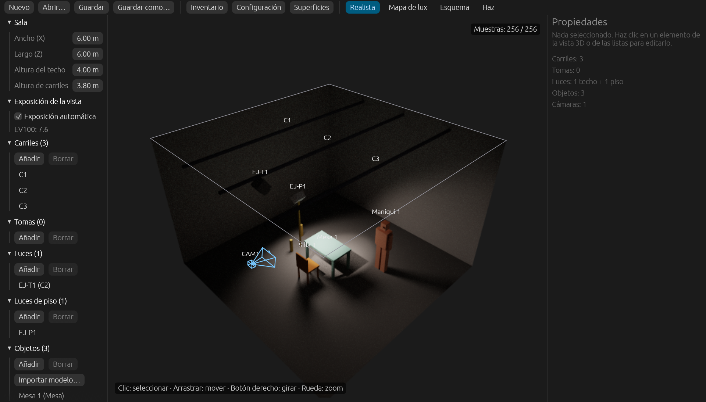
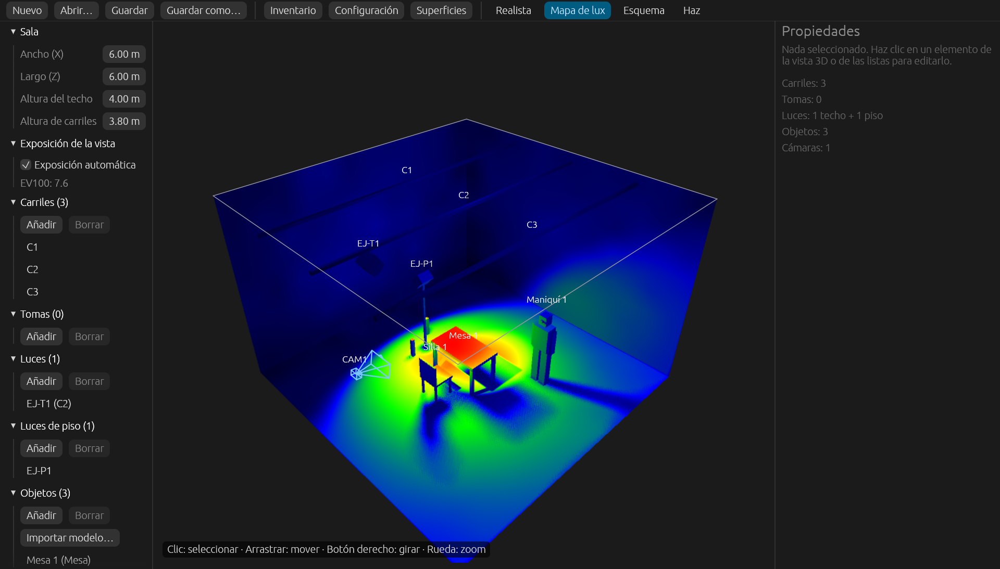
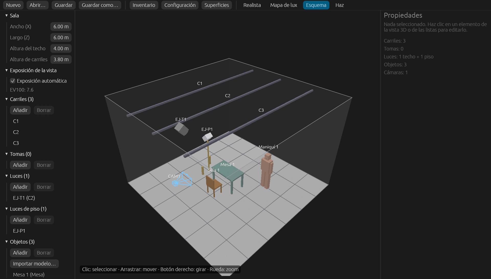

<div align="center">

# Sala de luces

**Planifica y simula la iluminación de un set de grabación en 3D.**

Coloca focos en los carriles del techo, conéctalos a sus tomas y mira cómo queda la luz antes de subir a la escalera.




<sub>Modo Fotorrealista: trazado de rayos progresivo (256 muestras) con un foco Fresnel en el carril C2 y una luz de pie.</sub>

</div>

---

## Qué hace

Sala de luces es una aplicación de escritorio para Windows (un solo `.exe`) que muestra en 3D una sala de grabación con carriles de luces en el techo. Sirve para dos cosas:

- **Planificar** un montaje: qué equipo va en cada carril, hacia dónde apunta y a qué toma se conecta.
- **Registrar** cómo quedó montada la sala, con un archivo por montaje.

Todo lo que hay en la sala se puede mover arrastrando en la vista 3D o escribiendo los valores en el panel.

<table>
  <tr>
    <td width="50%"></td>
    <td width="50%"></td>
  </tr>
  <tr>
    <td align="center"><b>Mapa de lux</b>: iluminancia en falso color sobre cada superficie.</td>
    <td align="center"><b>Esquema</b>: vista limpia para ubicar carriles, luces y objetos.</td>
  </tr>
</table>

## Funciones

### La sala
- Medidas editables: ancho, largo, altura del techo y altura de los carriles.
- Carriles paralelos de pared a pared; se añaden, se quitan y se mueven.
- Tomas en las paredes (a la altura de los carriles) o en el suelo, identificadas por código (`T-01`). En 3D se dibuja una línea de cada luz a su toma.
- Cotas temporales: al seleccionar un elemento se ven sus distancias a paredes y vecinos.
- Acabado propio para cada pared, el suelo y el techo (color y reflexión), con materiales de fábrica y presets guardados por el usuario.

### Luces
- Catálogo de equipos (código, marca, modelo): primero se da de alta el equipo y luego se coloca. Un mismo código no puede estar dos veces en un montaje.
- Tipos con datos de fabricante: Fresnel LED, panel LED, elipsoidal, PAR LED, space light, monoluz con softbox, tubo LED, ciclorama, luces de pie, Kino Flo Celeb 850 y FreeStyle 31, Fluotec CineLight 120 LT y otros.
- Cada luz tiene potencia, lux a 1 m, apertura, temperatura de color, CRI, dimmer e inclinación. Las Kino Flo admiten color (tono y saturación).
- Forma del haz según el emisor: los paneles dan una mancha rectangular, el elipsoidal un borde duro y el Fresnel uno suave.
- Perfiles **IES** reales del fabricante.

### Objetos y cámaras
- 28 formas de producción (sillas, mesas, maniquíes, trípodes…) organizadas por categorías.
- Importación de modelos **glTF / GLB / OBJ**, que se simplifican y quedan en una biblioteca propia.
- Maniquí con sombreado de piel (brillo especular y dispersión subsuperficial) y tono editable.
- Cámaras de escena con sensor, focal, ISO, diafragma, obturación, balance de blancos y foco. La vista de cámara usa su exposición y su encuadre, y en Fotorrealista añade profundidad de campo.

### Render
| Calidad | Cómo calcula la luz |
|---|---|
| **Rápida** | Mapas de sombras y luz rebotada estimada. Para equipos modestos. |
| **Alta** | Sombras suaves según el tamaño del emisor (PCSS) y luz rebotada por zonas con sondas de irradiancia. |
| **Fotorrealista** | Trazado de rayos en la GPU (BVH, muestreo de luces, varios rebotes) que se va afinando hasta el máximo de muestras y luego se detiene. |

- Unidades físicas: inverso del cuadrado, temperatura de color de cuerpo negro, exposición EV100 y tonemapping ACES.
- Botón **Haz** para ver el cono de cada luz como si hubiera humo en la sala.
- Quitarruido opcional con **Intel Open Image Denoise** para el modo Fotorrealista.
- Con la ventana en reposo el consumo de CPU es prácticamente nulo.

## Descargar y usar

1. Descarga `sala-luces.exe` desde [Releases](../../releases) (o compílalo, ver abajo).
2. Ábrelo. No hace falta instalar nada más.

Requisitos: Windows 10 u 11 y una tarjeta gráfica con **OpenGL 3.3**. Con OpenGL 2.0 solo funciona la vista básica. En portátiles con dos GPU el programa pide la dedicada (NVIDIA Optimus y AMD PowerXpress).

### Controles de la vista 3D

| Acción | Control |
|---|---|
| Seleccionar | Clic |
| Mover el elemento | Arrastrar |
| Girar la cámara | Botón derecho + arrastrar |
| Zoom | Rueda del ratón |

### Quitarruido (opcional)

Descarga [Intel Open Image Denoise 2.x](https://github.com/RenderKit/oidn/releases) para Windows y copia las DLL de la carpeta `bin` (`OpenImageDenoise.dll`, `OpenImageDenoise_core.dll`, `OpenImageDenoise_device_*.dll` y `tbb12.dll`) junto al `.exe` o en `%APPDATA%\SalaLuces\oidn\`. Si no están, la app funciona igual y la opción aparece como no disponible.

### Dónde se guardan los datos

Los montajes se guardan donde tú elijas (`.json`). La configuración, el inventario, los modelos importados, los presets de pared y los perfiles IES van en `%APPDATA%\SalaLuces\`.

## Compilar desde el código

Hace falta [Rust](https://rustup.rs/) estable. El proyecto se desarrolla con el toolchain GNU (`stable-x86_64-pc-windows-gnu`), que no necesita Visual Studio; MSVC también debería funcionar.

```powershell
git clone https://github.com/<tu-usuario>/sala-luces.git
cd sala-luces
cargo build --release
.\target\release\sala-luces.exe
```

Pruebas:

```powershell
cargo test
```

## Estructura

```
src/
├── main.rs         ventana y símbolos para usar la GPU dedicada
├── app.rs          interfaz: paneles, ventanas y edición
├── modelo.rs       montaje, sala, carriles, luces, objetos y cámaras (+ guardar/abrir)
├── escena.rs       geometría de la escena, selección y cotas
├── render_gl.rs    render OpenGL: sombras, sondas, mapa de lux, tonemapping
├── trazado.rs      trazador de rayos en GLSL (BVH en texturas)
├── fotometria.rs   cálculo de iluminancia, color de la luz y exposición
├── ies.rs          lectura de perfiles IES
├── importar.rs     importación de glTF/GLB/OBJ
├── inventario.rs   catálogo de equipos
├── quitarruido.rs  carga de Intel OIDN en tiempo de ejecución
├── config.rs       ajustes de calidad por GPU
└── geom.rs         vectores y utilidades
docs/superpowers/   especificaciones y planes de cada función
```

## Tecnología

[Rust](https://www.rust-lang.org/) · [egui / eframe](https://github.com/emilk/egui) con el renderizador glow (OpenGL) · shaders GLSL propios · [serde](https://serde.rs/) · [gltf](https://crates.io/crates/gltf) · [tobj](https://crates.io/crates/tobj) · [rfd](https://crates.io/crates/rfd) · [Intel OIDN](https://www.openimagedenoise.org/) (opcional)
